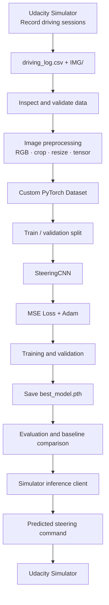
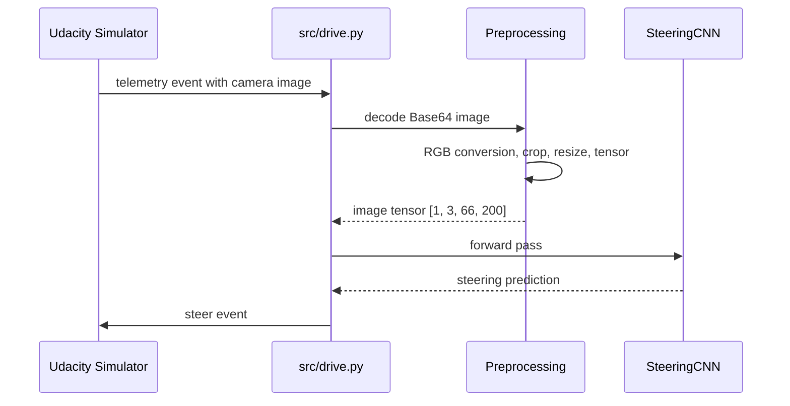
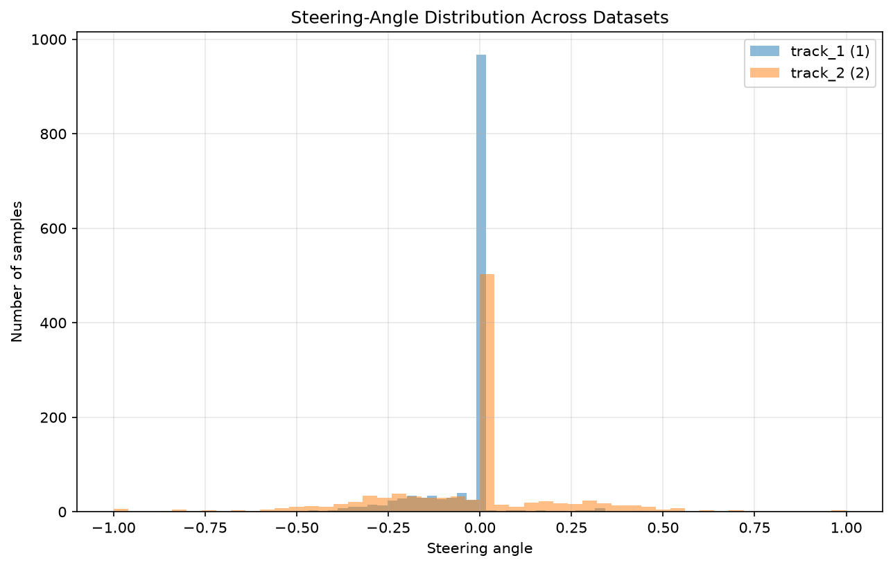
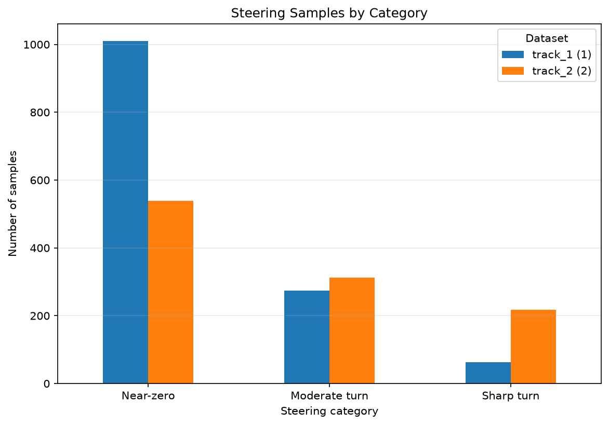
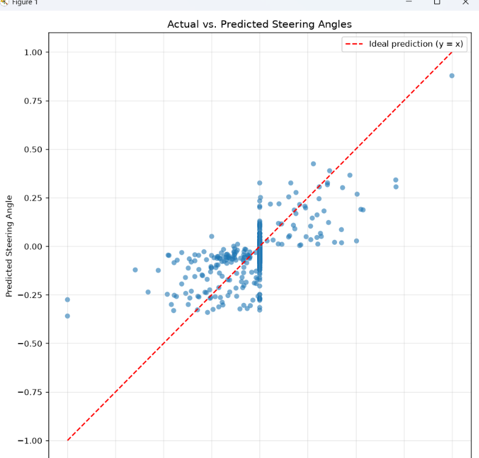
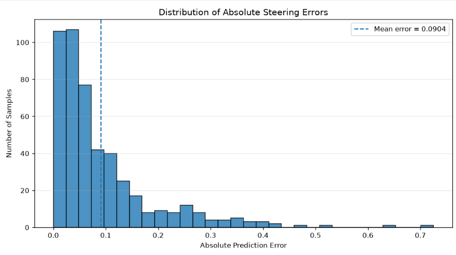
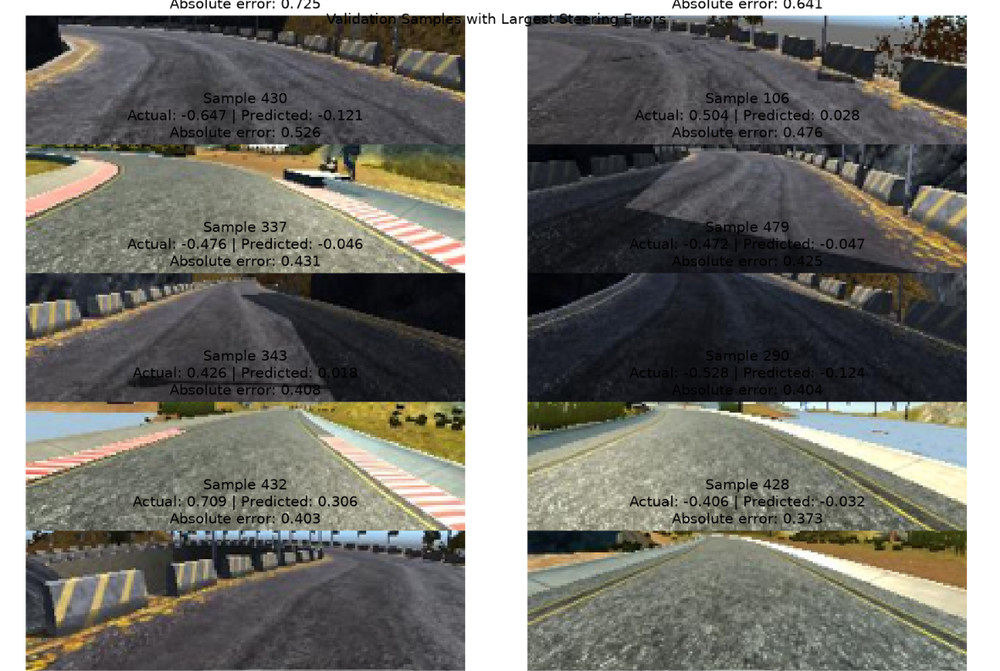

<div align="center">

# SelfDrivingAI
### End-to-End Autonomous Steering with Deep Learning

**Teaching a simulated car to steer from camera images using behavioral cloning and a CNN inspired by NVIDIA's end-to-end driving research.**

<p>
  
  
  
  
  
</p>

**[Overview](#-overview) · [Architecture](#-system-architecture) · [Results](#-current-results) · [Setup](#-installation) · [Usage](#-workflow) · [Roadmap](#-roadmap)**

</div>

---

## 📌 Overview

**SelfDrivingAI** is an end-to-end behavioral-cloning project that learns to predict a steering command directly from a front-facing camera image. Instead of manually programming every steering rule, the model learns visual patterns from images paired with steering labels recorded while driving in the Udacity Self-Driving Car Simulator.

The project is built as a modular machine-learning pipeline:

- 🗂️ Inspect and validate recorded driving data.
- 🖼️ Preprocess camera images into model-ready tensors.
- 🧠 Train a convolutional neural network (CNN) for steering regression.
- 📉 Evaluate predictions using regression metrics and visual diagnostics.
- 🎮 Connect model inference to the simulator through Socket.IO.

> **Project status:** Dataset processing, CNN shape testing, training/evaluation scripts, baseline comparison, and a simulator client script have been developed. A successful, reliable autonomous driving run has **not yet been confirmed**. Treat the model as experimental.

## ✨ Features

- **Behavioral cloning:** learn a mapping from camera images to steering values.
- **NVIDIA-inspired CNN:** convolutional feature extraction followed by fully connected regression layers.
- **PyTorch pipeline:** dataset loading, GPU-aware training, validation, and checkpointing.
- **Data validation:** check CSV records, image paths, tensor shapes, and label values.
- **Quantitative evaluation:** MSE, MAE, RMSE, and a mean-steering baseline.
- **Prediction diagnostics:** compare predicted and actual steering values and inspect large errors.
- **Simulator integration:** Socket.IO client for receiving telemetry and sending steering commands.
- **Reproducible dependencies:** project environment managed with `uv`.

## 🧭 System Architecture



### Inference loop



## 🧰 Tech Stack

| Component | Technology |
|---|---|
| Language | Python |
| Deep learning | PyTorch |
| Image processing | Pillow, NumPy |
| Data processing | pandas |
| Visualization | Matplotlib |
| Progress display | tqdm |
| Dataset splitting | scikit-learn |
| Simulator communication | `python-socketio` client |
| Environment and dependencies | `uv` |
| Driving environment | Udacity Self-Driving Car Simulator |
| Hardware acceleration | CUDA when available |

## 🗂️ Project Structure

The main files developed so far are organized as follows. Adjust this tree if your local repository contains additional scripts.

```text
SelfDrivingAI/
├── data/
│   ├── track_1/
│   │   ├── driving_log.csv
│   │   └── IMG/
│   └── track_2/
│       ├── driving_log.csv
│       └── IMG/
├── models/
│   └── best_model.pth
├── src/
│   ├── inspect_data.py
│   ├── visualize_data.py
│   ├── preprocess_image.py
│   ├── dataset.py
│   ├── split_data.py
│   ├── model.py
│   ├── train.py
│   ├── evaluate.py
│   ├── analyze_results.py
│   └── drive.py
├── pyproject.toml
├── uv.lock
└── README.md
```

**Data and checkpoint note:** `data/`, `models/best_model.pth`, and `uv.lock` may be created locally depending on your workflow. Avoid committing large raw datasets or model checkpoints unless you intend to distribute them.

## 🧠 Model Design

The CNN is inspired by NVIDIA's paper:

> Bojarski et al., *End to End Learning for Self-Driving Cars* (2016).  
> Paper: https://arxiv.org/abs/1604.07316

### Input and output

| Property | Configuration |
|---|---|
| Input image | RGB image |
| Preprocessed tensor | `3 × 66 × 200` |
| Batch input | `[batch_size, 3, 66, 200]` |
| Task | Continuous steering-angle regression |
| Output | One steering prediction per image |
| Output batch shape | `[batch_size, 1]` |
| Loss | Mean Squared Error (MSE) |
| Optimizer | Adam |

The implemented architecture uses five convolutional layers followed by fully connected layers and a single steering output. The input image is converted to a tensor and normalized to the `[0, 1]` range by the current preprocessing pipeline.

**Implementation note:** This project is NVIDIA-inspired, not a claim of an exact reproduction of every preprocessing choice or training detail in the paper.

## 📊 Dataset

The current local dataset consists of two simulator recordings:

| Dataset | Recorded rows | Camera images across center, left, and right |
|---|---:|---:|
| Track 1 | 1,347 | 4,041 |
| Track 2 | 1,069 | 3,207 |
| **Total** | **2,416** | **7,248** |

The current `CustomDataset` uses **center-camera images** with the associated steering labels. Left and right camera images are present in the recorded dataset but are not currently included as independent training examples in the described dataset implementation.

### Data split

| Split | Samples | Proportion |
|---|---:|---:|
| Training | 1,932 | 80% |
| Validation | 484 | 20% |
| Total | 2,416 | 100% |

The split currently uses shuffled sample indices with a fixed random seed. Because neighboring video frames can be very similar, a random split can make validation metrics optimistic. A separate held-out recording or track should be used to assess generalization.

### Dataset format

The CSV is expected to contain seven columns, in this order:

1. Center image path
2. Left image path
3. Right image path
4. Steering
5. Throttle
6. Brake
7. Speed

The dataset implementation reads the center image path and steering label for training.

## 📈 Current Results

The reported evaluation on the current 484-sample validation split:

| Metric | Mean-steering baseline | CNN | CNN improvement |
|---|---:|---:|---:|
| MSE | 0.033045 | **0.017784** | 46.18% |
| MAE | 0.110402 | **0.090415** | 18.10% |
| RMSE | 0.181782 | **0.133357** | 26.64% |

The CNN outperforms a constant predictor that always predicts the mean training steering angle on this validation split. This is encouraging evidence that the model learns image-dependent steering patterns.

### Interpretation and limitations

- Some individual predictions are close to their labels, while some turn examples have substantial errors.
- The data contains many near-zero steering labels, which can bias a model toward straight driving.
- Results from a random split of the same recordings do not establish performance on unseen tracks.
- These metrics alone do not prove that the car can complete a lap safely or reliably.

**Next evaluation goals:** inspect large-error samples, plot predicted versus actual steering, evaluate on a held-out track, and test simulator behavior cautiously.

## ⚙️ Installation

### Prerequisites

- Windows, Linux, or macOS
- Python version compatible with the dependencies in `pyproject.toml`
- [`uv`](https://docs.astral.sh/uv/)
- Udacity Self-Driving Car Simulator for simulator testing
- NVIDIA GPU with a compatible PyTorch/CUDA setup (optional; CPU execution is supported)

### 1. Clone the repository

Replace the URL below with your repository URL if needed:

```bash
git clone https://github.com/SUJITH-PEDAPATI/Self_Driving_Car.git
cd Self_Driving_Car
```

If your local project directory is named `SelfDrivingAI`, use that directory name when navigating into it.

### 2. Install project dependencies

If the repository already contains a valid `pyproject.toml` and `uv.lock`:

```bash
uv sync
```

If you are setting up dependencies manually, make sure your `pyproject.toml` is correctly configured for your source layout before running `uv add`. Do not blindly create a package directory just to silence a build error.

The main packages used by the project include:

```text
torch
torchvision
pandas
numpy
Pillow
matplotlib
scikit-learn
tqdm
python-socketio[client]
```

Use the dependency versions in your project configuration where available.

### 3. Verify PyTorch and CUDA

```bash
uv run python -c "import torch; print('PyTorch:', torch.__version__); print('CUDA available:', torch.cuda.is_available()); print('GPU:', torch.cuda.get_device_name(0) if torch.cuda.is_available() else 'CPU')"
```

CUDA availability depends on your installed PyTorch build and NVIDIA driver.

### 4. Verify Socket.IO dependencies

```bash
uv run python -c "import socketio, engineio; print('Socket.IO:', socketio.__version__); print('Engine.IO:', engineio.__version__)"
```

The Python client and simulator must use compatible Socket.IO/Engine.IO protocols. Installing the client packages alone does not guarantee a successful simulator connection.

## 🚀 Workflow

Run commands from the repository root so that imports such as `from src.model import SteeringCNN` resolve correctly.

### 1. Inspect the recorded data

```bash
uv run python -m src.inspect_data
```

Check the CSV columns, row counts, steering distribution, and image paths. Use the actual script options if your implementation defines any.

### 2. Visualize data samples

```bash
uv run python -m src.visualize_data
```

Inspect image quality, crop boundaries, and whether the displayed images correspond to the expected steering labels.

### 3. Test preprocessing

```bash
uv run python -m src.preprocess_image
```

Run this only if the module has a runnable test entry point. Otherwise, use the test command or script you created for preprocessing.

Expected model input for one image:

```text
torch.float32
Shape: [3, 66, 200]
Pixel range: [0, 1]
```

### 4. Validate the dataset and split

```bash
uv run python -m src.dataset
uv run python -m src.split_data
```

These commands require the corresponding files to contain executable test sections (`if __name__ == "__main__":`). If they do not, run the existing test script instead.

### 5. Test the model

```bash
uv run python -m src.model
```

Expected input batch: `[32, 3, 66, 200]`  
Expected output batch: `[32, 1]`

### 6. Train the model

```bash
uv run python -m src.train
```

The training script currently uses its configured number of epochs, batch size, learning rate, and device selection. It reports training and validation losses and saves the best checkpoint to:

```text
models/best_model.pth
```

### 7. Evaluate the model

```bash
uv run python -m src.evaluate
```

This loads the saved checkpoint and reports MSE, MAE, RMSE, and example predictions against recorded steering labels.

### 8. Analyze baseline performance

```bash
uv run python -m src.analyze_results
```

The current analysis compares the CNN with a mean-steering baseline and reports relative improvements on the validation set.

### 9. Connect to the simulator

Start the Udacity simulator and confirm the expected host, port, event names, and protocol version. Then, from the repository root:

```bash
uv run python -m src.drive
```

The current client is configured for `http://127.0.0.1:4567`; change this only if your simulator uses a different address or port.

**Caution:** Keep the initial test controlled and be ready to stop the simulation. Verify steering sign, scale, image preprocessing, and telemetry compatibility before allowing the car to move. The current throttle is set to `0.0`; driving behavior and successful autonomous operation remain to be validated.

## 🧪 Evaluation Metrics

For ground-truth steering \(y_i\) and predicted steering \(\hat{y}_i\):

**Mean Squared Error**

\[
\mathrm{MSE}=\frac{1}{N}\sum_{i=1}^{N}(y_i-\hat{y}_i)^2
\]

**Mean Absolute Error**

\[
\mathrm{MAE}=\frac{1}{N}\sum_{i=1}^{N}|y_i-\hat{y}_i|
\]

**Root Mean Squared Error**

\[
\mathrm{RMSE}=\sqrt{\mathrm{MSE}}
\]

Lower values indicate smaller errors on the evaluated dataset. Always interpret metrics alongside prediction plots and testing on genuinely unseen recordings.

## 🛣️ Roadmap

- [x] Record simulator driving data on two tracks
- [x] Validate image paths and inspect sample images
- [x] Implement image preprocessing and a custom PyTorch dataset
- [x] Split data into training and validation subsets
- [x] Implement and shape-test the CNN
- [x] Implement training, validation, and best-checkpoint saving
- [x] Evaluate using MSE, MAE, and RMSE
- [x] Compare against a mean-steering baseline
- [x] Create a Socket.IO-based simulator client script
- [ ] Confirm successful simulator connection and telemetry
- [ ] Verify steering convention and inference preprocessing end-to-end
- [ ] Plot prediction and error distributions
- [ ] Evaluate on a separate held-out track
- [ ] Improve turn and recovery behavior with better data coverage
- [ ] Complete a controlled autonomous lap and document results

## 📊 Data Analysis & Model Evaluation

The repository includes plots in `docs/images/` to document the dataset and the CNN's validation behavior. These visualizations are generated from the collected driving data and model evaluation; they should be regenerated whenever the dataset or checkpoint changes.

### Steering-angle distribution

This graph shows how steering labels are distributed across the collected driving data. A large concentration near zero indicates that straight-driving samples dominate the dataset, which can make sharp turns harder to learn.



### Steering categories

The steering-category chart groups labels into ranges so the dataset balance can be inspected more easily. Use it to identify whether moderate and sharp turns are underrepresented.



### Actual vs. predicted steering angles

Each point represents a validation sample. The dashed red line is ideal prediction (`predicted = actual`); points farther from this line have larger errors.



### Distribution of absolute steering errors

The histogram shows the frequency of absolute prediction errors. The dashed line marks the reported mean absolute error of approximately `0.0904` for the current evaluation.



### Validation samples with the largest steering errors

These examples highlight images where predicted steering differs significantly from the recorded label. They are useful for diagnosing poor turn handling and identifying where additional data collection may help.



### Steering-category counts

The category-count CSV (`docs/steering-category-counts.csv` (adjust the path if your CSV is stored elsewhere)) can be used to inspect the number of samples in each steering category or to regenerate category charts. If your CSV is stored in a different folder, update the path accordingly.

## 📚 References

1. Bojarski et al., [End to End Learning for Self-Driving Cars](https://arxiv.org/abs/1604.07316).
2. [PyTorch documentation](https://pytorch.org/docs/stable/index.html).
3. [PyTorch `Conv2d`](https://docs.pytorch.org/docs/stable/generated/torch.nn.Conv2d.html).
4. [PyTorch `MSELoss`](https://docs.pytorch.org/docs/stable/generated/torch.nn.MSELoss.html).
5. [python-socketio client documentation](https://python-socketio.readthedocs.io/en/latest/client.html).
6. [uv documentation](https://docs.astral.sh/uv/).

## 👨‍💻 Author

**Sujith Pedapati**

- GitHub: [@SUJITH-PEDAPATI](https://github.com/SUJITH-PEDAPATI)
- LinkedIn: [Sujith Pedapati](https://www.linkedin.com/in/pedapati-sujith-100124344/)

---

<div align="center">

**Built to learn, experiment, and improve — one steering prediction at a time.** 🚗🧠

</div>
